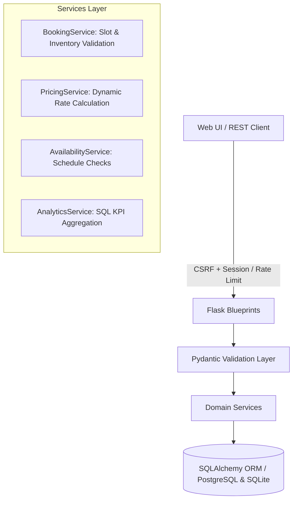

# 🏸 CourtBook Pro — Full-Stack Sports Court Booking System

[](https://court-book-pro-r6oj.vercel.app)
[](https://python.org)
[](https://flask.palletsprojects.com/)
[](https://neon.tech)
[](https://github.com/Spidey173/CourtBook-Pro)

A full-stack court booking and resource management system built with **Python**, **Flask**, **SQLAlchemy**, and **PostgreSQL**. Features atomic multi-slot reservation logic, dynamic rule-based pricing, role-based access control, and an interactive customer & admin dashboard.

---

## 🌐 Live Demo & Credentials

👉 **Production URL**: **[https://court-book-pro-r6oj.vercel.app](https://court-book-pro-r6oj.vercel.app)**

### Test Accounts

| Role | Username | Password | Accessible Features |
| :--- | :--- | :--- | :--- |
| **Admin** | `admin` | `Admin@123456` | Operations dashboard, court/coach/equipment CRUD, pricing rules, booking logs |
| **Player** | `demo_user` | `Demo@123456` | Court availability browser, multi-resource checkout, match history |

*(Or use the 1-Click Quick Login buttons on the login screen.)*

---

## 💡 Key Engineering Features

*   **Conflict-Free Slot Allocation**: Multi-hour bookings break into individual hourly slot records (`BookingSlot`) protected by a database-level composite unique constraint `(court_id, date, time_slot)` to prevent double-booking.
*   **Server-Side Pricing Engine**: Pricing is computed strictly on the backend (`PricingService`) using configurable business rules (base price, peak-hour multipliers, weekend rates, equipment add-ons, coach fees, and multi-hour discounts), preventing client-side tampering.
*   **Layered Application Architecture**: Organized using Flask Application Factory pattern with clean separation across Blueprints (Routes) $\rightarrow$ Pydantic validation $\rightarrow$ Domain Services $\rightarrow$ SQLAlchemy ORM models.
*   **Authentication & Security**:
    *   Secure password hashing via Werkzeug (`scrypt` / `pbkdf2:sha256`).
    *   Session-based authentication with `Flask-Login` and role verification decorators (`@admin_required`).
    *   CSRF token protection on form posts and API requests (`X-CSRFToken`).
    *   Endpoint rate-limiting via `Flask-Limiter`.
*   **Multi-Database Ready**: Runs with in-memory SQLite for instant local test execution and Serverless PostgreSQL (Neon) with connection pooling in production.
*   **Automated Pytest Suite**: 37 automated tests covering authorization, booking conflict scenarios, pricing calculations, and admin APIs.

---

## 🏗️ Architecture & Data Flow



---

## 📂 Project Structure

```
CourtBook-Pro/
├── app/
│   ├── __init__.py            # Application factory (create_app)
│   ├── config.py              # Environment configuration (Dev, Test, Prod)
│   ├── extensions.py          # Flask extension instances (DB, Login, CSRF, Limiter)
│   ├── models/                # SQLAlchemy ORM Models
│   │   ├── user.py            # User account & authentication
│   │   ├── court.py           # Court definitions
│   │   ├── equipment.py       # Equipment inventory
│   │   ├── coach.py           # Coach profiles & rates
│   │   ├── booking.py         # Booking, BookingSlot (locks), BookingEquipment
│   │   └── pricing_rule.py    # Configurable pricing rules
│   ├── schemas/               # Pydantic input validation schemas
│   ├── services/              # Domain business logic
│   │   ├── pricing_service.py # Dynamic pricing calculations
│   │   ├── booking_service.py # Atomic booking & conflict checks
│   │   ├── availability_service.py # Real-time slot availability
│   │   └── analytics_service.py   # Dashboard KPI metrics
│   ├── blueprints/            # Route controllers
│   │   ├── auth/              # Login, register, logout
│   │   ├── main/              # User-facing reservation UI
│   │   ├── admin/             # Facility management & KPIs
│   │   └── api/               # JSON REST API endpoints
│   └── utils/                 # Decorators, error handlers, JSON helpers
├── migrations/                # Alembic schema migration scripts
├── static/                    # CSS design tokens, icons, and Vanilla JS clients
├── templates/                 # Jinja2 templates (Customer UI & Admin console)
├── tests/                     # Pytest automated test suite (37 tests)
├── cli.py                     # CLI utilities (db init, data seeding, admin creation)
├── run.py                     # Local development server entry point
├── api/index.py               # Vercel serverless entry point
├── vercel.json                # Vercel deployment routes configuration
└── requirements.txt           # Python dependencies
```

---

## 🚀 Getting Started Locally

### 1. Prerequisites
*   Python 3.10 or higher
*   Git

### 2. Setup Virtual Environment
```bash
# Clone the repository
git clone https://github.com/Spidey173/CourtBook-Pro.git
cd CourtBook-Pro

# Create and activate a virtual environment
python3 -m venv .venv
source .venv/bin/activate       # On Windows: .venv\Scripts\activate

# Install dependencies
pip install -r requirements.txt
```

### 3. Initialize Database & Seed Sample Data
```bash
# Create tables and load sample courts, coaches, equipment & pricing rules
python cli.py init-db
python cli.py seed-data

# Optional: Create custom admin account (default demo accounts already included in seed)
python cli.py create-admin --username admin --email admin@courtbook.com --password Admin@123456
```

### 4. Run the Development Server
```bash
python run.py
```
👉 Open **[http://127.0.0.1:5000](http://127.0.0.1:5000)** in your browser.

---

## 🧪 Testing

Run the automated test suite with Pytest:
```bash
pytest tests/ -v
```
All **37 tests** execute in an isolated in-memory SQLite database, verifying:
*   Authentication flows & duplicate user protection
*   Booking slot creation and double-booking conflict prevention
*   Dynamic pricing formulas across peak hours, weekends, and discounts
*   Role-based admin access control and CRUD endpoints

---

## 📡 REST API Reference

| Method | Endpoint | Description |
| :--- | :--- | :--- |
| `GET` | `/api/v1/courts` | List active courts |
| `GET` | `/api/v1/equipment` | List equipment items & available stock |
| `GET` | `/api/v1/coaches` | List active coaches and hourly rates |
| `GET` | `/api/v1/timeslots` | List operating booking time slots |
| `GET` | `/api/v1/pricing-rules` | Retrieve active pricing rules |
| `GET` | `/api/v1/availability` | Check court, coach, and equipment availability for a date |
| `POST` | `/api/v1/calculate-price` | Preview itemized price calculation |
| `GET` | `/api/v1/bookings` | Fetch booking history for authenticated user |
| `POST` | `/api/v1/bookings` | Create a new booking reservation |
| `POST` | `/api/v1/bookings/<id>/cancel` | Cancel booking and release slot locks |
| `GET` | `/api/v1/admin/stats` | Admin dashboard overview metrics (Admin only) |
| `GET` | `/api/v1/admin/reports/revenue` | Monthly revenue and booking summary (Admin only) |
