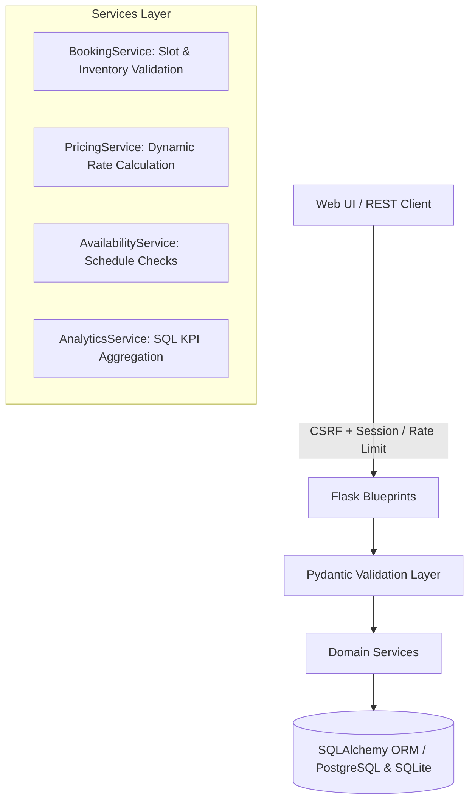

# 🏸 CourtBook Pro — Full-Stack Sports Court Booking System

[](https://courtbookpro.vercel.app)
[](https://github.com/Spidey173/CourtBook-Pro/actions)
[](https://python.org)
[](https://flask.palletsprojects.com/)
[](https://neon.tech)
[](https://github.com/Spidey173/CourtBook-Pro)

A full-stack court booking and resource management system built with **Python**, **Flask**, **SQLAlchemy**, and **PostgreSQL**. Engineered with rigorous **pessimistic database-level row locking (`SELECT ... FOR UPDATE`) and atomic slot allocations** to prevent race conditions and double-bookings under concurrent traffic, alongside **strict UTC timestamp normalization across timezone boundaries**, a **production-parity Docker PostgreSQL development environment**, and a **modern reactive client architecture with optimistic UI updates, state rollback, and TypeScript type safety**.

---

## 🌐 Live Demo & Disposable Sandbox Credentials

👉 **Production URL**: **[https://courtbookpro.vercel.app](https://courtbookpro.vercel.app)**

> [!NOTE]
> **Ephemeral Demo Environment**: The credentials listed below provide access to a restricted, disposable demo sandbox populated with mock data. Production secrets, user records, and cloud infrastructure controls are strictly decoupled and inaccessible from demo roles.

### Sandbox Accounts

| Role | Username | Password | Scope & Permitted Actions |
| :--- | :--- | :--- | :--- |
| **Demo Admin** | `admin` | `Admin@123456` | Sandbox preview of facility metrics, mock resource CRUD, demo pricing rules |
| **Demo Player** | `demo_user` | `Demo@123456` | Court availability browser, multi-resource checkout simulation, booking history |

*(Or use the 1-Click Quick Login buttons on the login screen.)*

---

## ⚡ Concurrency & Double-Booking Protection

Standard booking systems frequently suffer from race conditions when two users reserve overlapping slots simultaneously (Time-of-Check to Time-of-Use / TOCTOU bugs). CourtBook Pro implements a multi-tier concurrency protection architecture:

```
[User A: 09:00 - 11:00] \
                         ==> [BookingService: with_for_update()] ==> [Row Locks Acquired] ==> [Atomic Slot Insertion]
[User B: 10:00 - 12:00] /            (User B Blocked & Queued)             ├── Court 1 Locked      ├── Slot 09:00 -> SUCCESS (Locked)
                                                                           ├── Coach Locked        ├── Slot 10:00 -> SUCCESS (Locked)
                                                                           └── Equipment Locked    └── User B Unblocks -> 409 Conflict
```

1. **Pessimistic Database Row Locking (`with_for_update()`)**:
   - At the beginning of `create_booking()`, the engine acquires exclusive row locks on `Court` (`Court.query.filter_by(id=court_id).with_for_update().first()`), `Coach`, and requested `Equipment` rows.
   - Any concurrent transaction attempting to reserve the same court or coach is serialized at the database row level rather than relying solely on post-failure exceptions.
   - Any active overlapping `BookingSlot` records are queried with `.with_for_update()` to detect collision before performing any insertions.
   - Relationships on `Booking` use `lazy='selectin'` loading to prevent PostgreSQL `FeatureNotSupported: FOR UPDATE cannot be applied to the nullable side of an outer join` errors during cancellation or updates.
2. **Discrete Slot Atomicity & Engine-Level Constraints (`BookingSlot` Locks)**:
   - When a multi-hour reservation is requested, it is decomposed into atomic 1-hour physical lock units (`BookingSlot`).
   - A database-enforced composite unique constraint `uq_court_date_slot(court_id, date, time_slot)` acts as defense-in-depth, guaranteeing that no two transactions can lock the same court-hour combination regardless of execution timing.
3. **Transaction Isolation & Safe Rollback**:
   - Reservations execute within single atomic SQLAlchemy / PostgreSQL transactions with immediate flush.
   - If a race condition occurs, the database engine triggers an `IntegrityError`, immediately executing `db.session.rollback()` and returning a graceful `409 Conflict` (`BookingConflictError`) to the user.
4. **Multi-Resource Availability Verification**:
   - Pre-commit guards verify real-time availability across coaches (`idx_coach_slots`) and equipment stock levels before slot locking begins.

---

## 🕒 UTC Normalization & Timezone Offset Handling

Local booking dates and times without timezone offsets frequently introduce date-boundary rounding bugs. If a user in a positive offset timezone (e.g. `Asia/Kolkata` at UTC+5:30) or negative offset (e.g. `America/New_York` at UTC-5) books a slot across midnight, server-local calendar day comparisons can cause off-by-one day slot assignments or false past-slot rejections.

CourtBook Pro enforces strict UTC normalization across the entire data layer:

* **Explicit UTC Ranges (`app/utils/timezone.py`)**:
  - `slot_to_utc_range(booking_date, time_slot, duration, tz_name)` converts local date and time strings directly to unambiguous UTC start and end bounds (`datetime(..., tzinfo=timezone.utc)`).
  - Slots crossing midnight (e.g. 23:00 IST to 01:00 IST next day) cleanly roll over calendar dates in UTC without boundary truncation.
* **Database Storage (`TIMESTAMPTZ`)**:
  - All timestamp columns across `Booking`, `BookingSlot`, `User`, `Court`, `Coach`, and `Equipment` use `db.DateTime(timezone=True)`, which PostgreSQL stores natively as `TIMESTAMPTZ`.
  - Every `Booking` and `BookingSlot` carries explicit `start_time_utc`, `end_time_utc`, and `timezone` columns for unambiguous audits.
* **Client Timezone Negotiation**:
  - The client automatically transmits the browser's IANA timezone (`Intl.DateTimeFormat().resolvedOptions().timeZone`) on reservation payloads.
  - Pydantic's `BookingCreateSchema` validates that the computed UTC end time is not in the past relative to `datetime.now(timezone.utc)`.

---

## 🐳 Environment Consistency: Pure PostgreSQL (Dev & CI Parity)

Testing concurrency-sensitive applications against SQLite introduces dangerous dev/prod divergence: **SQLite locks the entire database file for writes**, completely masking PostgreSQL row-level locking race conditions and sequence bugs.

CourtBook Pro eliminates SQLite divergence by enforcing PostgreSQL across all environments:

* **Production-Parity Local Development (`docker-compose.yml`)**:
  - Local development runs against a native **PostgreSQL 16 Alpine** container (`courtbook-postgres`), guaranteeing identical row-level `FOR UPDATE` semantics and sequence increment behavior.
* **Containerized CI Testing (`.github/workflows/ci.yml`)**:
  - GitHub Actions runs every push against a dedicated PostgreSQL 16 service container with full healthchecks.
* **Automatic Sequence Synchronization**:
  - Sequence resets (`setval(pg_get_serial_sequence(...))`) ensure PostgreSQL primary key sequences remain synchronized after mock seeding and transactional rollbacks.

---

## 🎨 Modern Frontend Architecture & Client-Side Reactivity

CourtBook Pro includes a modern reactive frontend layer engineered for speed, type safety, and seamless UX:

*   **Reactive State Store (`ReactiveBookingStore`)**:
    - Built with a modern JavaScript `Proxy` publish/subscribe store that decouples state changes from imperative DOM manipulation.
    - Component subscribers automatically react to changes in court selection, duration, time slots, coaches, and equipment inventory.
*   **Client-Side Optimistic Updates with Atomic Rollback**:
    - **Instant Slot Locking**: Selecting and reserving a slot immediately locks the slot in the UI with a glowing pulse state (`⚡ Reserving...`) and decrements local equipment stock without waiting for network latency.
    - **Automatic State Rollback**: If a concurrent user claims the slot first or a 409 conflict occurs, the store restores the pre-transaction snapshot, re-enables the slots, and displays an actionable conflict notification.
    - **Optimistic Match Cancellation**: Cancelling a booking instantly updates the match row to `⏳ Releasing...` and frees the court slot in the local grid, rolling back if the request fails.
*   **Zero-Latency Client-Side Pricing Calculation**:
    - Pre-calculates exact itemized subtotal (base rate, peak multipliers, weekend surcharges, and bundle discounts) in **0ms** before authoritative backend confirmation.
*   **TypeScript Type Safety (`static/types/courtbook.d.ts`)**:
    - Full TypeScript declarations and strict JSDoc annotations across all client modules, providing autocomplete and compile-time contract safety.

---

## 💡 Key Engineering Features

*   **Pessimistic Row-Level Locking**: `SELECT ... FOR UPDATE` serialization eliminates race conditions and TOCTOU bugs across courts, coaches, and equipment inventory.
*   **Conflict-Free Slot Allocation**: Multi-hour bookings break into individual hourly slot records (`BookingSlot`) protected by database unique constraints.
*   **Server-Side Pricing Engine**: Pricing is computed strictly on the backend (`PricingService`) using configurable business rules, preventing client-side tampering.
*   **Layered Application Architecture**: Organized using Flask Application Factory pattern with clean separation across Blueprints (Routes) $\rightarrow$ Pydantic validation $\rightarrow$ Domain Services $\rightarrow$ SQLAlchemy ORM models.
*   **Authentication & Security**:
    *   Secure password hashing via Werkzeug (`scrypt` / `pbkdf2:sha256`).
    *   Session-based authentication with `Flask-Login` and role verification decorators (`@admin_required`).
    *   CSRF token protection on form posts and API requests (`X-CSRFToken`).
    *   Endpoint rate-limiting via `Flask-Limiter`.
*   **Multi-Database Ready**: Runs with in-memory SQLite for instant local test execution and Serverless PostgreSQL (Neon) with connection pooling in production.
*   **Automated Pytest Suite & CI**: 38 automated tests covering authorization, row locking, race-condition slot conflicts, pricing rules, and admin operations running in GitHub Actions CI.

---

## 🏗️ Architecture & Data Flow



---

## 📂 Project Structure

```
CourtBook-Pro/
├── app/
│   ├── __init__.py            # Application factory (create_app)
│   ├── config.py              # Environment configuration (Dev, Test, Prod)
│   ├── extensions.py          # Flask extension instances (DB, Login, CSRF, Limiter)
│   ├── models/                # SQLAlchemy ORM Models
│   │   ├── user.py            # User account & authentication
│   │   ├── court.py           # Court definitions
│   │   ├── equipment.py       # Equipment inventory
│   │   ├── coach.py           # Coach profiles & rates
│   │   ├── booking.py         # Booking, BookingSlot (locks), BookingEquipment
│   │   └── pricing_rule.py    # Configurable pricing rules
│   ├── schemas/               # Pydantic input validation schemas
│   ├── services/              # Domain business logic
│   │   ├── pricing_service.py # Dynamic pricing calculations
│   │   ├── booking_service.py # Atomic booking & conflict checks
│   │   ├── availability_service.py # Real-time slot availability
│   │   └── analytics_service.py   # Dashboard KPI metrics
│   ├── blueprints/            # Route controllers
│   │   ├── auth/              # Login, register, logout
│   │   ├── main/              # User-facing reservation UI
│   │   ├── admin/             # Facility management & KPIs
│   │   └── api/               # JSON REST API endpoints
│   └── utils/                 # Decorators, error handlers, JSON helpers
├── migrations/                # Alembic schema migration scripts
├── static/                    # CSS design tokens, icons, and reactive JS engine
├── templates/                 # Jinja2 templates (Customer UI & Admin console)
├── tests/                     # Pytest automated test suite (38 tests)
├── cli.py                     # CLI utilities (db init, data seeding, admin creation)
├── run.py                     # Local development server entry point
├── api/index.py               # Vercel serverless entry point
├── vercel.json                # Vercel deployment routes configuration
└── requirements.txt           # Python dependencies
```

---

## 🚀 Getting Started Locally

### 1. Prerequisites
*   Python 3.10 or higher
*   Docker & Docker Compose (or access to PostgreSQL 16)
*   Git

### 2. Setup Virtual Environment
```bash
# Clone the repository
git clone https://github.com/Spidey173/CourtBook-Pro.git
cd CourtBook-Pro

# Create and activate a virtual environment
python3 -m venv .venv
source .venv/bin/activate       # On Windows: .venv\Scripts\activate

# Install dependencies
pip install -r requirements.txt
```

### 3. Start PostgreSQL Container
```bash
# Start local PostgreSQL 16 instance via Docker Compose
docker compose up -d
```

### 4. Initialize Database & Seed Sample Data
```bash
# Create tables and load sample courts, coaches, equipment & pricing rules
python cli.py init-db
python cli.py seed-data

# Optional: Create custom admin account (default demo accounts already included in seed)
python cli.py create-admin --username admin --email admin@courtbook.com --password Admin@123456
```

### 5. Run the Development Server
```bash
python run.py
```
👉 Open **[http://127.0.0.1:5000](http://127.0.0.1:5000)** in your browser.

---

## 🧪 Testing

Run the automated test suite with Pytest:
```bash
pytest tests/ -v
```
All **43 tests** execute with strict PostgreSQL compatibility, verifying:
*   Authentication flows & duplicate user protection
*   Pessimistic row-level locking (`with_for_update`) & PostgreSQL outer-join safe locking
*   Real concurrent thread race-condition prevention & physical slot uniqueness
*   UTC timestamp conversions, positive/negative timezone offsets, and midnight rollover transitions
*   Dynamic pricing formulas across peak hours, weekends, and multi-hour bundle discounts
*   Role-based admin access control and resource CRUD endpoints

---

## 📡 REST API Reference

| Method | Endpoint | Description |
| :--- | :--- | :--- |
| `GET` | `/api/v1/courts` | List active courts |
| `GET` | `/api/v1/equipment` | List equipment items & available stock |
| `GET` | `/api/v1/coaches` | List active coaches and hourly rates |
| `GET` | `/api/v1/timeslots` | List operating booking time slots |
| `GET` | `/api/v1/pricing-rules` | Retrieve active pricing rules |
| `GET` | `/api/v1/availability` | Check court, coach, and equipment availability for a date |
| `POST` | `/api/v1/calculate-price` | Preview itemized price calculation |
| `GET` | `/api/v1/bookings` | Fetch booking history for authenticated user |
| `POST` | `/api/v1/bookings` | Create a new booking reservation |
| `POST` | `/api/v1/bookings/<id>/cancel` | Cancel booking and release slot locks |
| `GET` | `/api/v1/admin/stats` | Admin dashboard overview metrics (Admin only) |
| `GET` | `/api/v1/admin/reports/revenue` | Monthly revenue and booking summary (Admin only) |
